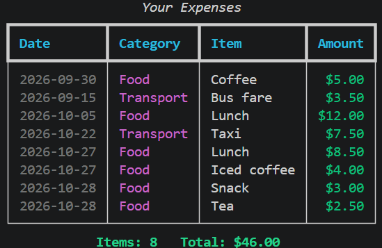
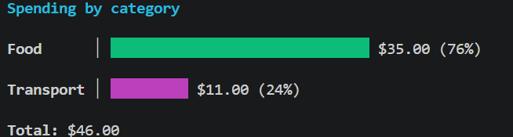

# Finance Tracker

A command-line expense tracker written in Python. Add expenses, filter them by category, see monthly totals and spending trends, and view a bar chart of spending by category, all in a colored terminal UI built with [rich](https://github.com/Textualize/rich).

## Screenshots





## Features

- Add expenses with validation: real dates, positive amounts, no empty fields
- List all expenses or filter by category, with an item count and total
- Monthly totals and month-over-month spending trends
- Bar chart of spending by category
- Two ways to use it: an interactive menu, or one-line commands
- Expenses are saved to a JSON file
- Object-oriented design (`Expense` and `ExpenseTracker` classes) with a pytest test suite

## Requirements

- Python 3.10 or newer (developed on 3.14)

## Installation

```
git clone https://github.com/Hameed-code47/Finance-tracker.git
cd Finance-tracker
python -m venv venv
venv\Scripts\activate
pip install -r requirements.txt
```

On macOS or Linux, activate the virtual environment with `source venv/bin/activate` instead.

## Usage

### Interactive menu

```
python src/main.py
```

### Commands

| Command | What it does |
| --- | --- |
| `python src/main.py add 2026-10-29 Food Lunch 8.5` | Add an expense (date, category, item, amount) |
| `python src/main.py add 2026-10-29 Food "Iced coffee" 4` | Use quotes when the item has spaces |
| `python src/main.py list` | Show all expenses |
| `python src/main.py list --category food` | Show one category only |
| `python src/main.py summary 2026-10` | Total spending for a month |
| `python src/main.py trend 2026-10` | Compare a month with the month before |
| `python src/main.py chart` | Bar chart of spending by category |

## Running the tests

```
python -m pytest -v
```

## Project structure

```
Finance-tracker/
├── src/
│   ├── main.py          # Expense, ExpenseTracker and the command-line interface
│   └── expenses.json    # saved expenses
├── tests/
│   └── test_main.py     # pytest tests
├── requirements.txt
├── LICENSE
└── README.md
```

## Roadmap

- A Flask web version
- AI-powered spending insights

## License

See the [LICENSE](LICENSE) file.