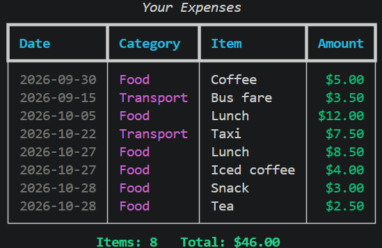
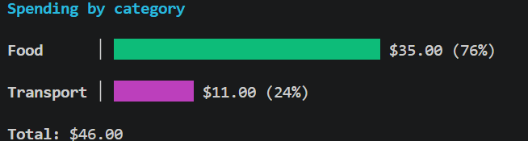

# Finance Tracker

[](https://github.com/Hameed-code47/Finance-tracker/actions/workflows/tests.yml)

A personal expense tracker built with Python, available as a Flask web app and a command-line application.

Record expenses, explore category totals, and understand your monthly spending.

**[Open the live web app](https://finance-tracker-uldk.onrender.com)**

## Live demo

The web app runs on Render, with PostgreSQL storage on Neon and shared rate-limit counters in Render Key Value.

The deployment is currently intended for testing:

- The free web service sleeps after inactivity, so the first visit may take longer to load.
- Password-reset emails are captured in a private Mailtrap sandbox. Testers cannot receive reset emails in their personal inboxes yet.
- Accounts and expenses created locally are separate from those created on the live website.
- Use sample data while evaluating the app.

## Features

### Web app

- Register, log in, and log out.
- Keep each user's expenses separate.
- Add and edit expenses with field-level validation.
- Delete expenses through a confirmation page.
- Restrict editing and deletion to the expense owner.
- Reject future expense dates, using Nigerian time.
- Store amounts as integer kobo and display them in Nigerian naira.
- View expense history and all-time spending totals.
- Select a month to view totals and category breakdowns.
- View a category bar chart and recent expenses on the dashboard.
- Use responsive pages on desktop and smaller screens.
- Show or hide passwords using eye buttons.
- Request password-reset links that expire after 15 minutes.
- Reject reused reset links and invalidate existing login sessions after a successful reset.
- Protect forms with CSRF tokens and store hashed passwords.
- Limit login submissions to 5 per minute per detected IP address.
- Limit password-reset requests to 3 per 15 minutes per detected IP address.

People sharing the same public IP address may share a rate limit.

### Command-line app

- Add expenses through an interactive menu or one-line commands.
- List expenses and filter them by category.
- View monthly totals and month-over-month spending trends.
- Display category spending in a coloured terminal chart.
- Save expenses to a JSON file.
- Use a terminal interface built with [Rich](https://github.com/Textualize/rich).

The CLI and web app use separate storage. CLI records are not automatically imported into the web database.

## Screenshots

### CLI expense table



### CLI spending chart



## Requirements

- Python 3.14, used for current development and automated testing.
- Git to clone the repository.
- A web browser for the Flask app.
- Mailtrap Email Sandbox credentials to test password-reset emails.

The web chart loads Chart.js from a CDN and requires an internet connection. Exact category totals remain available in a table if the chart cannot load.

## Installation

Clone the repository and create a virtual environment:

```powershell
git clone https://github.com/Hameed-code47/Finance-tracker.git
cd Finance-tracker
python -m venv venv
```

Activate it in Windows PowerShell:

```powershell
.\venv\Scripts\Activate.ps1
```

On macOS or Linux:

```bash
source venv/bin/activate
```

Install dependencies:

```bash
python -m pip install -r requirements.txt
```

Gunicorn is installed on supported platforms and skipped on Windows.

## Run the web app locally

### 1. Configure environment variables

Create `.env` in the project root, beside `app.py`.

Generate a secret key:

```bash
python -c "import secrets; print(secrets.token_hex(32))"
```

Use the generated key and your Mailtrap sandbox SMTP credentials:

```dotenv
SECRET_KEY=replace_with_your_generated_secret_key
APP_BASE_URL=http://127.0.0.1:5000

MAIL_SERVER=sandbox.smtp.mailtrap.io
MAIL_PORT=2525
MAIL_USERNAME=replace_with_your_mailtrap_username
MAIL_PASSWORD=replace_with_your_full_mailtrap_password
MAIL_FROM="Finance Tracker <no-reply@example.com>"
```

Use the full Mailtrap password rather than its masked display.

Keep the secret key stable between restarts. Changing it invalidates signed sessions and password-reset links.

Keep `.env` excluded from Git.

For normal local development, leave `DATABASE_URL` and `RATELIMIT_STORAGE_URI` unset. The app defaults to:

- SQLite at `instance/finance.db`.
- In-memory rate-limit storage.
- Development cookie settings suitable for local HTTP.

### 2. Create database tables

```bash
python -m flask --app app init-db
```

This creates missing tables. It does not migrate changes to existing table definitions.

### 3. Start Flask

```bash
python -m flask --app app run --debug
```

Open [the registration page](http://127.0.0.1:5000/register), create an account, and add an expense.

Use the debug server for local development only.

## Using the web app

| Page | Purpose |
| --- | --- |
| `/register` | Create an account |
| `/login` | Log in |
| `/` | View the monthly dashboard |
| `/expenses` | View expense history and all-time total |
| `/expenses/new` | Add an expense |
| `/expenses/<id>/edit` | Edit an expense you own |
| `/expenses/<id>/delete` | Confirm deletion of an expense you own |
| `/summary` | View monthly totals and category spending |
| `/forgot-password` | Request a password-reset link |

Passwords must contain 15–128 characters, including a number and a symbol.

Enter expense amounts in naira, such as `1250.50`. The app stores this as `125050` kobo.

Expense dates must be today or earlier, based on Nigerian time.

Deletion takes place only after submitting the confirmation form. Logout also uses a POST form.

## Password recovery

Mailtrap Email Sandbox captures test emails. Access to the sandbox is required to retrieve reset links during testing.

1. Register a test account.
2. Select **Forgot password?** on the login page.
3. Submit the account's email address.
4. Open the newest reset email in Mailtrap.
5. Follow the link and choose a new password.
6. Log in using the new password.
7. Reopen the same reset link to confirm it is rejected.

For local testing, open the link on the computer running Flask. Hosted reset links use the configured public `APP_BASE_URL`.

Links expire after 15 minutes. A successful reset invalidates previously issued reset links for that account and existing login sessions on their next request.

Recovery pages use `Cache-Control: no-store` and `Referrer-Policy: strict-origin`. The referrer policy permits HTTPS form checks while excluding the reset token from referrer headers.

## Deployment

The current deployment uses:

| Component | Service |
| --- | --- |
| Flask application | Render Web Service |
| Application server | Gunicorn |
| Accounts and expenses | Neon PostgreSQL |
| Rate-limit counters | Render Key Value |
| Test email capture | Mailtrap Email Sandbox |

The web service and Key Value instance run in Frankfurt. The Neon database also uses Frankfurt.

### Render web-service settings

| Setting | Value |
| --- | --- |
| Language | Python 3 |
| Branch | `main` |
| Root directory | Repository root |
| Build command | `pip install -r requirements.txt` |
| Health check path | `/login` |

Start command:

```bash
gunicorn app:app --bind 0.0.0.0:$PORT --workers 1 --threads 2 --timeout 60
```

### Hosted environment variables

Configure these privately in Render:

| Variable | Purpose |
| --- | --- |
| `APP_ENV` | Set to `production` to enable HTTPS-only session cookies |
| `PYTHON_VERSION` | Current deployment uses `3.14.4` |
| `SECRET_KEY` | Stable, randomly generated deployment secret |
| `DATABASE_URL` | Full Neon PostgreSQL connection URL |
| `RATELIMIT_STORAGE_URI` | Render Key Value internal connection URL |
| `APP_BASE_URL` | Public HTTPS base address of the deployed app |
| `TRUSTED_PROXY_HOPS` | Verified forwarding count for the deployment |
| `MAIL_SERVER` | SMTP host |
| `MAIL_PORT` | SMTP port |
| `MAIL_USERNAME` | SMTP username |
| `MAIL_PASSWORD` | SMTP password |
| `MAIL_FROM` | Sender name and email address |

Keep database TLS parameters from the Neon connection URL.

The application selects Psycopg for PostgreSQL URLs. Run `init-db` against the intended database during initial setup before using the app.

The current Render deployment uses `TRUSTED_PROXY_HOPS=3`. This was checked against observed request headers, including a request containing a deliberately forged forwarding address. Recheck this setting when changing hosts or proxy configuration.

Render supplies the `RENDER` environment variable used to enable the hosted proxy configuration.

### Storage and operational limits

- Hosted accounts and expenses are stored in Neon.
- Rate-limit storage uses Render Key Value with `noeviction`.
- The free Key Value instance can lose its counters on restart.
- Local development and automated tests use in-memory rate-limit storage.
- PostgreSQL connection pooling uses a connection health check before checkout.
- The current automated database tests run against SQLite. Live PostgreSQL behaviour also needs deployment testing.
- Production email delivery, database migrations, and a backup-and-restore process remain planned work.

## CLI usage

### Interactive menu

```bash
python src/main.py
```

### One-line commands

| Command | What it does |
| --- | --- |
| `python src/main.py add 2026-10-29 Food Lunch 8.5` | Add an expense |
| `python src/main.py add 2026-10-29 Food "Iced coffee" 4` | Add an item containing spaces |
| `python src/main.py list` | Show all expenses |
| `python src/main.py list --category food` | Filter by category |
| `python src/main.py summary 2026-10` | Show a monthly total |
| `python src/main.py trend 2026-10` | Compare with the previous month |
| `python src/main.py chart` | Show category spending |

The CLI can run independently of the web database and email configuration.

## Automated tests

Run the complete suite:

```bash
python -m pytest -v
```

Run only the web tests:

```bash
python -m pytest tests/test_web.py -v
```

The current suite contains **67 tests**:

- **14 CLI tests**.
- **53 web test cases** covering authentication, CSRF protection, expense ownership, adding/editing/deleting expenses, field validation, date restrictions, password recovery, and rate limits.

Web tests use an isolated in-memory SQLite database, in-memory rate-limit storage, and a fake email sender.

The test setup checks the database connection before creating or deleting tables and refuses to continue unless it is the expected in-memory database.

### Continuous integration

GitHub Actions installs dependencies and runs the suite on pushes and pull requests. The workflow can also be started manually.

[View automated test runs](https://github.com/Hameed-code47/Finance-tracker/actions)

### Live checks

Deployment checks have included:

- Account creation and login.
- Saving an expense and finding it after logging in again.
- Password-reset email capture and successful password changes.
- Rejection of reused reset links.
- Login throttling and access recovery after the limit window.
- Password-reset request throttling.
- HTTPS detection and visitor-IP handling.

## Project structure

```text
Finance-tracker/
├── .github/
│   └── workflows/
│       └── tests.yml
├── instance/
│   └── finance.db
├── screenshots/
│   ├── chart.png
│   └── table.png
├── src/
│   ├── main.py
│   └── expenses.json
├── static/
│   └── css/
│       └── app.css
├── templates/
│   ├── base.html
│   ├── add_expense.html
│   ├── delete_expense.html
│   ├── expenses.html
│   ├── login.html
│   ├── password_recovery.html
│   ├── register.html
│   └── summary.html
├── tests/
│   ├── conftest.py
│   ├── test_main.py
│   └── test_web.py
├── .env
├── .gitignore
├── app.py
├── design.md
├── email_service.py
├── models.py
├── requirements.txt
├── LICENSE
└── README.md
```

The add-expense template also handles editing. Shared expense-page layout and styles live in `base.html` and `static/css/app.css`.

Local files such as `.env` and `instance/finance.db` are created during setup and excluded from Git.

## Roadmap

- Deliver password-reset emails to testers' real inboxes.
- Add database migrations and a backup-and-restore process.
- Expand PostgreSQL integration testing.
- Add web app screenshots.
- Collect tester feedback and improve usability.
- Explore AI-powered spending insights.

## License

See the [LICENSE](LICENSE) file.